<div align="center">

# OSIRIS

### Abandoned But Not Forgotten

**A bilingual (English / العربية) pixel-art story game about the real machines NASA left behind on the Moon and Mars.**

[](https://mohamedashrafabdelwahab.github.io/OSIRIS-Nilestro/)

**[▶ PLAY THE LIVE DEMO](https://mohamedashrafabdelwahab.github.io/OSIRIS-Nilestro/)** · no install, runs in any browser

Built by **Team NileStro** (Egypt) for the **[NASA Space Apps Challenge 2026](https://www.spaceappschallenge.org/2026/challenges/nasas-discarded-equipment-storytelling)** — challenge *“Abandoned but not Forgotten: Storytelling about NASA’s Discarded Equipment on the Moon and Mars.”*

</div>

---

> **A fictional story about real machines.** Tariq and Zain’s adventure is our own narrative — but every piece of equipment you meet in the game is genuine NASA hardware left behind on the Moon and Mars, and every fact is drawn from the official NASA sources linked in the built-in **Mission Manual** and in the [data attribution table](#science-inside-nasa-data--sources) below.

---

## Gallery

| Main menu | In-game — the damaged cockpit |
| --- | --- |
| 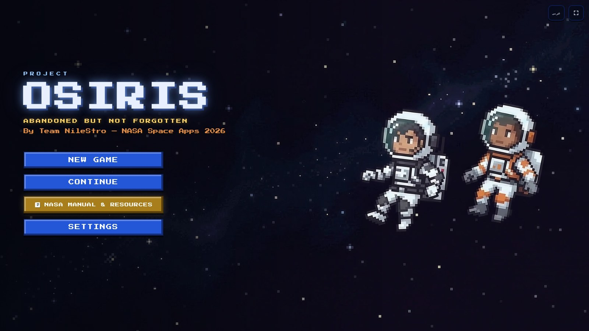 | 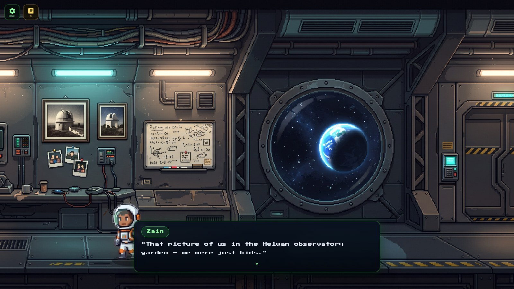 |

| Walking beside the LRV (Apollo rover valley) | The Eagle’s resting place — Tranquility Base |
| --- | --- |
| 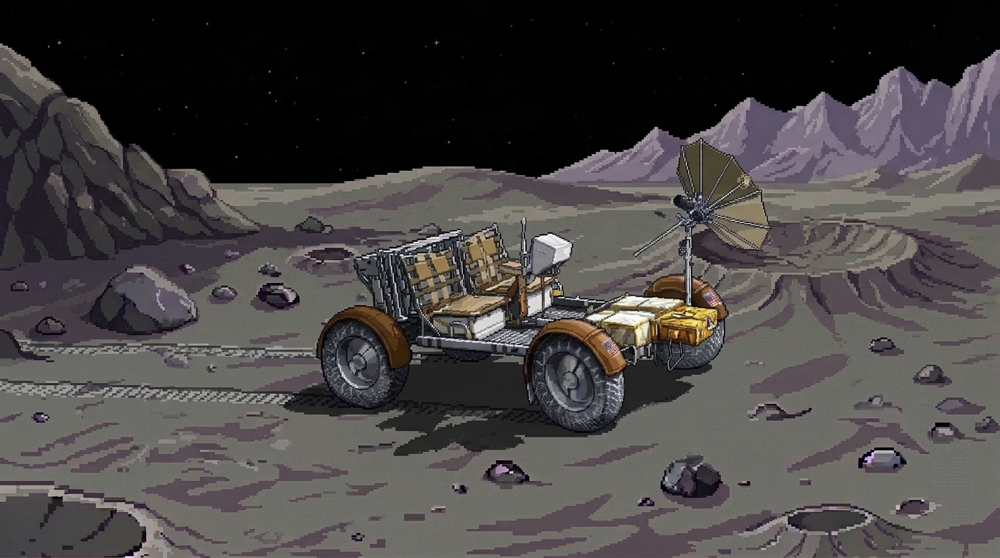 | 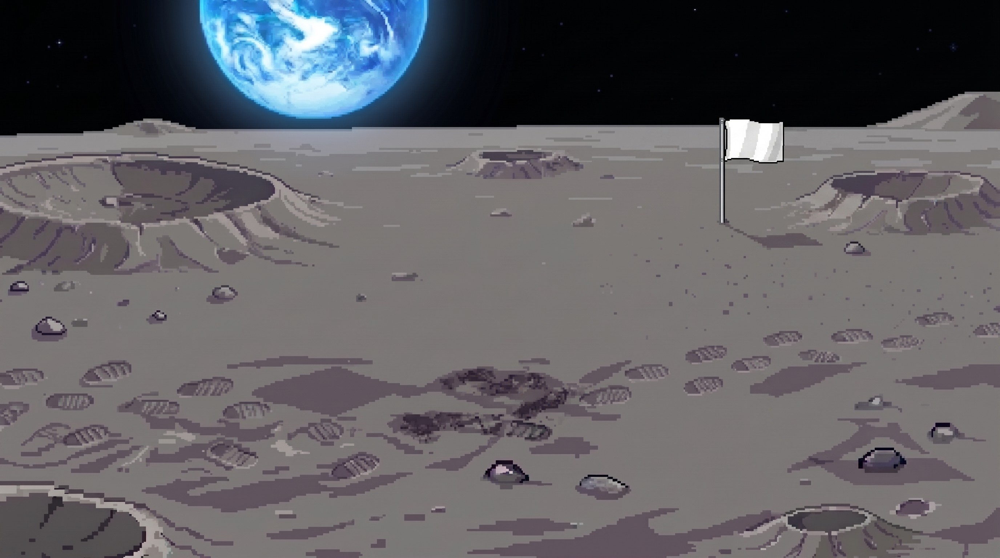 |

| Mars — InSight station | Mars — Opportunity on Endeavour’s rim |
| --- | --- |
| 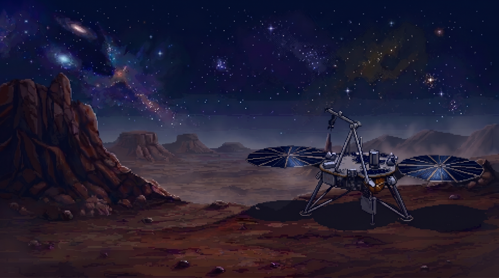 | 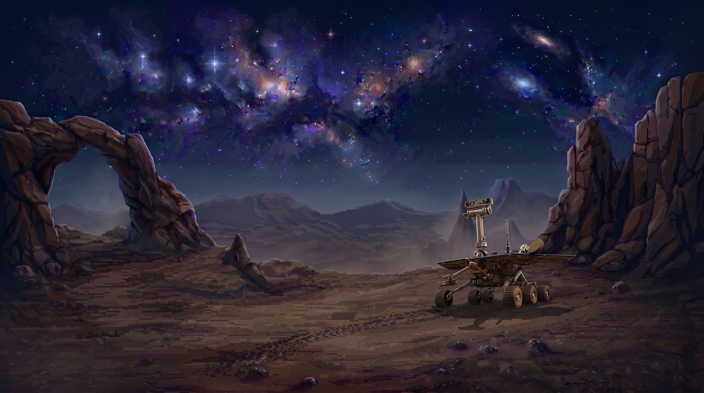 |

| The built-in NASA Mission Manual (Machines tab) | The Manual’s data-sources tab |
| --- | --- |
| 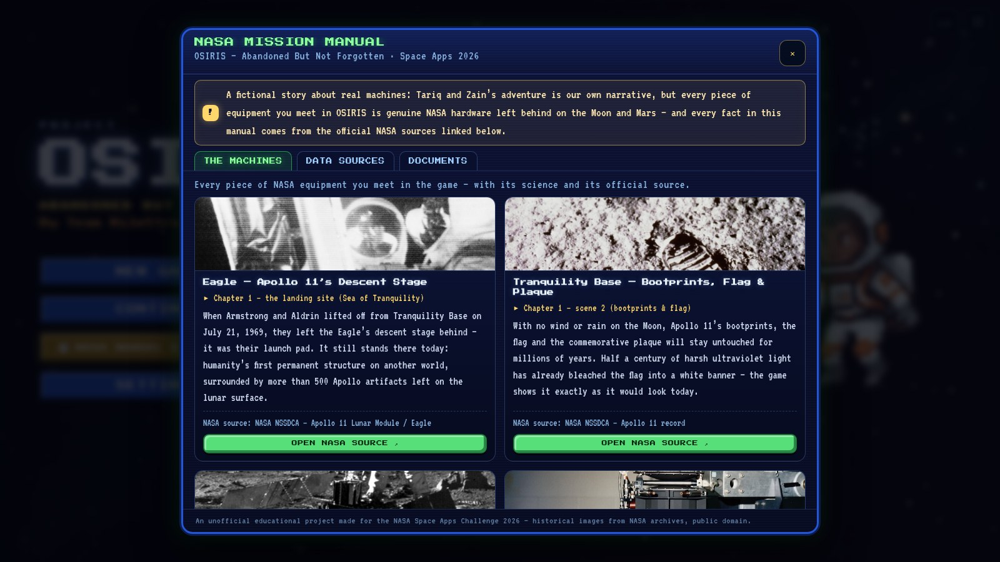 | 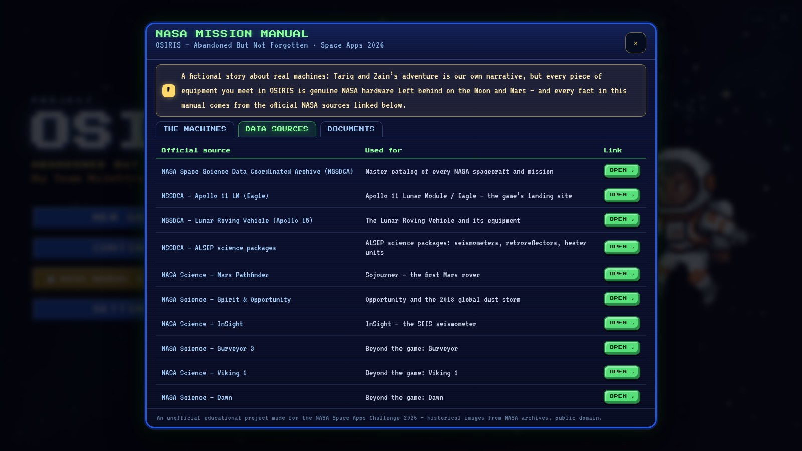 |

| The 3D Comic Book (English) | الكوميك ثلاثي الأبعاد (العربية) | The Silent Archive (PDF) |
| --- | --- | --- |
| 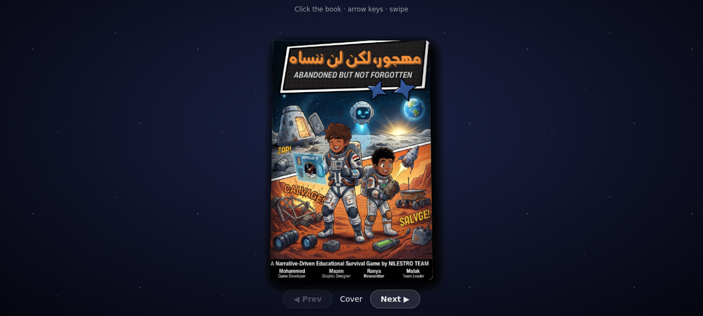 | 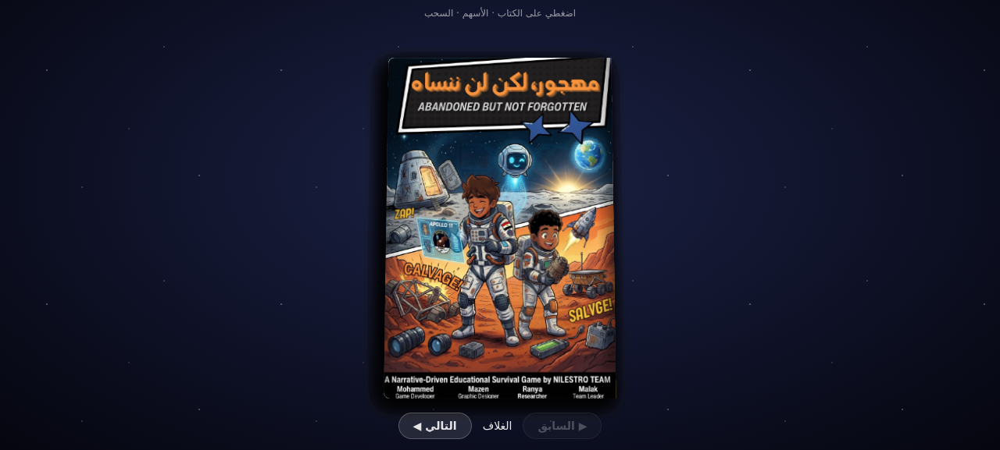 | 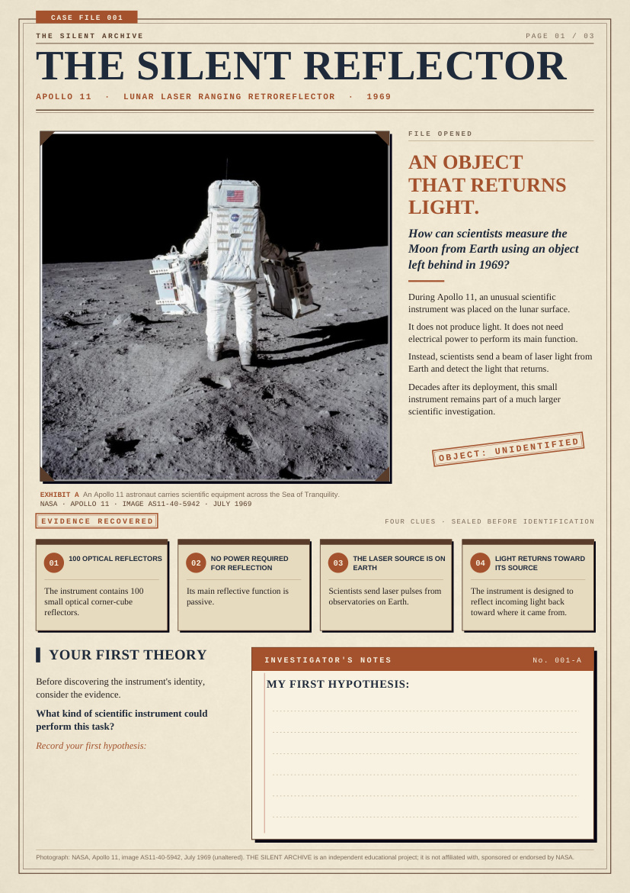 |

<details>
<summary><strong>Companion documents — suggested screenshots to add</strong></summary>

Drop these files at these exact paths and they will appear here automatically:

| 3D Comic Book (interactive HTML) | The Silent Archive (PDF) |
| --- | --- |
|  |  |

</details>

---

## The Story

Since the 1960s, NASA has left hardware across the solar system — rovers, landers, probes and instruments that finished their science missions and now stand silently as monuments to exploration. **OSIRIS: Abandoned But Not Forgotten** turns that hidden heritage into a playable, story-driven adventure for school-age space enthusiasts.

Two siblings — **Tariq**, the propulsion engineer, and **Zain**, the science researcher — fly a joint mission to document humanity’s discarded equipment:

- **Chapter 1 — The Moon:** after a micrometeorite storm cripples their spacecraft, Zain is stranded in orbit and Tariq crash-lands at a real Apollo site. He walks through the actual leftovers of the Apollo program — the bootprints, the sun-bleached flag, the *Eagle*’s descent stage, the PSEP seismometer, an RHU nuclear heater, the LRRR laser reflector and the Lunar Roving Vehicle — repairing, measuring and broadcasting his way back to orbit using the same science the machines were built for.
- **Chapter 2 — Mars, the Space Heritage Garden:** the journey continues to Mars to visit three real robotic explorers — **Sojourner**, **InSight** and **Opportunity** — and ends with a heartfelt reunion on the Martian plain, under a real blue sunset.
- **Post-credits epilogue:** the player steps “behind the scenes” into NileStro HQ and walks through the four offices of the development team.

Everything the player meets is a real machine with a real mission history. The narrative shows *how the hardware operated and what science it made possible*, rather than listing facts — and the built-in **Mission Manual** (book icon, or press `M`) backs every machine with its official NASA source, one click away.

---

## Features

- **Built-in NASA Mission Manual & Resources** — an in-game reference window (from the main menu, the book icon during play, or press `M`) with a science dossier for every machine in the game, its official NASA source name, and a direct clickable link — plus the full data-source table from the challenge resources page.
- **Bilingual by design** — English (default) and Arabic, switchable any time; Arabic gets full right-to-left layout.
- **Cinematic main menu** — live animated background with full asset preloading and a real progress bar: no black screens or missing assets during play.
- **Two full chapters** — 25+ walkable rooms on the Moon and Mars with pixel-art characters, interactive points, and science puzzles (laser calibration, thermal defrost, signal focusing).
- **Dialogue system** — bilingual, character-by-character typing with mechanical keyboard sound design.
- **Full touch support** — on phones and tablets the game auto-detects touch, shows on-screen controls (left arrow bottom-left, right arrow + E bottom-right), accepts direct taps on the floating E badges, asks you to rotate to landscape in portrait, and locks landscape inside fullscreen where the browser allows it.
- **Interactive team epilogue** — meet the four team members behind the game, in-game.
- **Companion documents** — a **3D flip-through comic book** (opens in the game’s current language, English or العربية) and **The Silent Archive**, a detailed science case-file PDF — both downloadable in-game (Settings → Files) and from the Manual’s Documents tab.
- **Local saves** — progress is stored in the browser (localStorage) and can be continued any time.
- **Zero dependencies** — pure HTML5 + CSS + vanilla JavaScript. No build step, no framework, no server, no database.

## Controls

| Input | Action |
| --- | --- |
| `←` `→` or `A` `D` | Move |
| `E` *(or tap the floating badge)* | Interact with equipment, doors and characters |
| `X` / click / tap | Advance dialogue · skip cutscenes |
| `M` | Open the NASA Mission Manual & Resources |
| `Esc` / `Tab` | Settings during play |
| On-screen buttons | Full touch controls on mobile — no keyboard needed |

---

## Science Inside: NASA Data & Sources

Every machine in OSIRIS is real, and every fact comes from NASA’s official archives — the [NASA Space Science Data Coordinated Archive (NSSDCA)](https://nssdc.gsfc.nasa.gov/) and NASA Science mission pages, exactly as listed on the challenge’s resources page. The same table lives inside the game’s Mission Manual with one-click links.

| Equipment in the game | What it is | Official NASA source |
| --- | --- | --- |
| **Eagle** descent stage | Apollo 11’s launch pad on the Moon — humanity’s first permanent structure on another world | [NSSDCA — Apollo 11 LM (Eagle)](https://nssdc.gsfc.nasa.gov/nmc/spacecraft/display.action?id=1969-059C) |
| Tranquility Base artifacts | Bootprints, sun-bleached flag and plaque, preserved for millions of years | [NSSDCA — Apollo 11 record](https://nssdc.gsfc.nasa.gov/nmc/spacecraft/display.action?id=1969-059C) |
| **PSEP** seismometer | First seismometer on another world (Apollo 11, 1969); the ALSEP network recorded moonquakes until 1977 | [NSSDCA — ALSEP science packages](https://nssdc.gsfc.nasa.gov/nmc/spacecraft/display.action?id=1969-099C) |
| **RHU** heater units | Plutonium-238 warmth that kept experiments alive through −170 °C lunar nights | [NSSDCA — master catalog](https://nssdc.gsfc.nasa.gov/) |
| **LRRR** retroreflector | 100 corner-cube mirrors, no batteries — still measuring the Moon’s 3.8 cm/year drift today | [NSSDCA — ALSEP science packages (retroreflectors)](https://nssdc.gsfc.nasa.gov/nmc/spacecraft/display.action?id=1969-099C) |
| **LRV** lunar rover | The first electric car on the Moon — 90 km driven across Apollo 15–17, parked forever | [NSSDCA — Lunar Roving Vehicle](https://nssdc.gsfc.nasa.gov/nmc/spacecraft/display.action?id=1971-063C) |
| **Sojourner** | The first rover on Mars (1997), delivered by Pathfinder | [NASA Science — Mars Pathfinder](https://science.nasa.gov/mission/mars-pathfinder/) |
| **InSight** | Listened to 1,300+ marsquakes and proved Mars has a liquid core | [NASA Science — InSight](https://science.nasa.gov/mission/insight/) |
| **Opportunity** | Built for 90 days, explored for 15 years and 45+ km | [NASA Science — Spirit & Opportunity](https://science.nasa.gov/mission/mars-exploration-rovers-spirit-and-opportunity/) |

The Manual’s **Data Sources** tab also documents NASA’s wider family of discarded machines from the same official list — [Surveyor](https://science.nasa.gov/mission/surveyor-3/), [Viking 1](https://science.nasa.gov/mission/viking-1/), Spirit, Phoenix, [Dawn](https://science.nasa.gov/mission/dawn/), [NEAR Shoemaker](https://science.nasa.gov/mission/near-shoemaker/), [Pioneer 10](https://science.nasa.gov/mission/pioneer-10/), [Ingenuity](https://science.nasa.gov/mission/mars-2020-perseverance/ingenuity-mars-helicopter/) and [Kepler](https://science.nasa.gov/mission/kepler/) — each with its direct link.

## For Educators & Younger Readers

Two companion documents ship with the game (in-game via Settings → Files, or the Manual’s **Documents** tab):

| Document | Audience | Where |
| --- | --- | --- |
| **3D Comic Book** — the story retold as an interactive flip-through comic, in English and العربية (opens in your current game language) | Younger readers | [`assets/docs/comic-en.html`](assets/docs/comic-en.html) · [`assets/docs/comic-ar.html`](assets/docs/comic-ar.html) |
| **The Silent Archive** — a detailed “case file” science investigation into NASA’s discarded equipment | Educators & deep readers | [`assets/docs/the-silent-archive.pdf`](assets/docs/the-silent-archive.pdf) |

---

## Run It

The game is a fully static site — any static host works:

### GitHub Pages *(this is how the live demo is deployed)*
1. **Settings → Pages → Deploy from a branch → `main` / `(root)`**
2. Open `https://<your-username>.github.io/OSIRIS-Nilestro/`

### Vercel
1. **Add New… → Project**, import this repository.
2. Preset **Other** (plain static site — no build command, output = repo root).

### itch.io
1. Zip the repository with `index.html` at the zip root.
2. Upload as an **HTML game**, tick “This file will be played in the browser”.

### Locally
Open `index.html` in a browser, or serve the folder: `python3 -m http.server`.

> **Note:** the game preloads its media (~190 MB with all cutscene videos) before unlocking play — on a first visit give the progress bar a few seconds. Progress is cached afterwards.

---

## Repository Structure

```
index.html        Entry point: main menu + scene 1 + scene 2 (single page)
scene1.html       History-log screen (optional standalone page)
scene2.html       Gameplay (optional standalone page)
css/
  menu.css        Start screen & settings modal
  scene1.css      CRT archive screen
  scene2.css      Gameplay engine UI (dialogue, puzzles, touch controls…)
  manual.css      NASA Mission Manual & Resources window
js/
  assets.js       Media manifest — the single source of every asset path
  preload.js      Full asset preloading with byte-level progress
  i18n.js         English/Arabic dictionary
  manual.js       NASA Mission Manual & Resources (equipment dossiers + sources)
  main.js         Menu logic, language, fullscreen, saves, scene sequencing
  scene1.js       CRT history-log scene
  scene2.js       Full gameplay engine (ship → Moon → Mars → epilogue)
assets/           Images, videos, codex archive photos, companion documents (3D comic + PDF)
screenshots/      README screenshots
```

## Controls Recap & Accessibility

- Keyboard-first design with physical-key codes (`KeyA`/`KeyD`/`KeyE`), so layouts work on Arabic and other keyboards.
- Full touch parity on mobile — the game is fully playable without a keyboard.
- ARIA labels on interactive controls; dialogue text is announced politely to screen readers.

---

## Team NileStro

| Member | Role |
| --- | --- |
| **Malak Kotp** | Team leader — biotechnology researcher, scientific data analysis, 3D comic book |
| **Ranya Ibrahem** | Scientific content researcher — verified every mission fact from NASA sources, narrative dialogue, educational PDF |
| **Mohamed Ashraf** | Web developer — **17 years old** — built the entire game engine in HTML5/JS/CSS, pixel-art assets, sound design, deployment |
| **Mazen Ashraf** | Navigation science & space technology engineer — orbital trajectory design, systems thinking, narrative structure |

## AI Tools Disclosure

In the spirit of the Space Apps Challenge rules, we disclose every AI tool used in this project:

| Task | Tool |
| --- | --- |
| Image generation (pixel-art characters, scene backgrounds) | **Nano Banana Pro** |
| Video generation (cinematic cutscenes) | **OmniFlash** |
| Programming assistance (code review, refactoring help) | **Antigravity** and **OpenCode** (powered by the GLM model) |

All mission facts and scientific content were researched and verified by the team’s human science researchers from the official NASA sources listed above.

---

## Credits & Rights

- Historical images used in the story scenes and the Mission Manual are from NASA archives and are in the **public domain**.
- Fonts: [Press Start 2P](https://fonts.google.com/specimen/Press+Start+2P), [VT323](https://fonts.google.com/specimen/VT323) and [Handjet](https://fonts.google.com/specimen/Handjet) — SIL Open Font License.
- Game code, story and original art © **Team NileStro** — made for the NASA Space Apps Challenge 2026.
- This is an unofficial educational project. NASA does not endorse non-U.S. Government entities, and is not responsible for the content of this game.

> *Abandoned in space… but never forgotten.*
